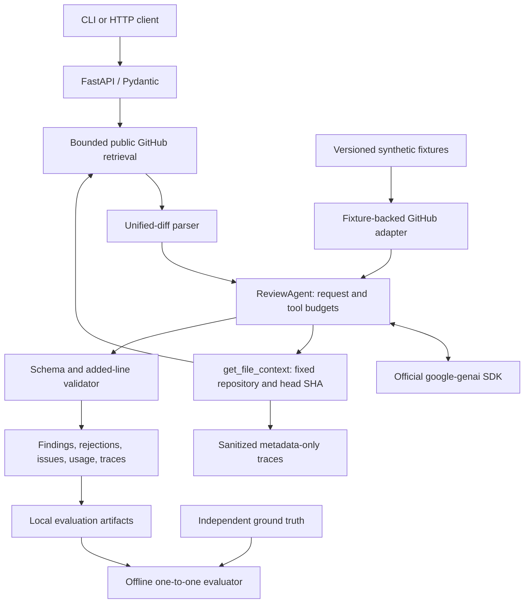

# PR Sentinel — Agentic AI Code Review Engine

PR Sentinel is a read-only code-review service for public GitHub pull requests. A bounded Gemini agent can inspect additional source context and propose findings; deterministic Python validation checks every finding against the actual added lines in the PR.

The project demonstrates constrained function calling, explicit failure handling, reproducible evaluation, and privacy-conscious observability. **Stages 1–5 are implemented.** It is a portfolio project with production-inspired packaging, not a hosted service or an automatic security approval system.

## Features

- Public PR retrieval with pagination, repository/head-SHA binding, and strict URL validation.
- Unified-diff parsing and exact added-line validation, including explicit rejection reasons.
- Opt-in Gemini reviews with manual tool execution, structured JSON output, and hard budgets.
- Sanitized SDK diagnostics; no automatic retries or model failover.
- Bounded tool traces containing paths/ranges and outcomes, never retrieved source content.
- A 25-case synthetic benchmark, deterministic offline replay, and separately approved live evaluation.
- Non-root Docker packaging, pinned dependency snapshots, offline tests, and GitHub Actions CI.

## Architecture and technology



Python 3.12+, FastAPI, Pydantic v2, HTTPX, the official Google Gen AI SDK, Pytest, Ruff, setuptools, Docker, and GitHub Actions. No database, vector store, orchestration framework, paid observability service, repository code execution, or GitHub write access is required.

The analysis phase permits only `get_file_context(path, start_line, end_line)`. The application validates and dispatches each call itself; SDK automatic function execution is disabled. The final phase disables tools and requests structured findings. Stage 2 validates those findings independently. Repository instructions cannot grant new tools or change the repository/ref.

## Quick start

```bash
python3.12 -m venv .venv
source .venv/bin/activate
python -m pip install --no-deps -r requirements-build.lock
python -m pip install --no-deps -r requirements-dev.lock
python -m pip install --no-deps --no-build-isolation -e .
python -m pip check
uvicorn app.main:app --host 127.0.0.1 --port 8000
```

`GET http://127.0.0.1:8000/health` works without credentials. Interactive API documentation is at `/docs`. The dependency files pin versions; they do not contain distribution hashes. A package-index connection is required for installation unless the wheels are already cached.

### Gemini and free-tier configuration

Copy `.env.example` to `.env` only if you do not already have a local `.env`, then edit it locally. Never commit credentials. The application reads process environment and does not load `.env` automatically.

```dotenv
GEMINI_API_KEY=<your-local-key>
GEMINI_MODEL=gemini-3.5-flash-lite
GEMINI_FREE_TIER_CONFIRMED=true
AI_THINKING_LEVEL=
```

Use a project without billing and independently confirm model/account free-tier eligibility before enabling live requests. The confirmation flag is operator attestation, not a billing API check. Gemini 3.5 Flash-Lite is configurable; no model is hardcoded as a runtime default. Blank thinking level uses the provider's default; explicit `low`, `medium`, or `high` is supported by the existing configuration. Do not change the primary model merely to run a comparison—use a per-command environment override.

To load a file you control in bash/zsh:

```bash
set -a
source .env
set +a
```

`GITHUB_TOKEN` is optional for public PR retrieval. It does not enable private repositories. Read `.env.example` for all settings. Default AI limits are **4 model requests, 3 tools, 20,000 initial-context characters, 200 source lines per tool, 10,000 tool-payload characters, 4,096 output tokens, a 30-second model timeout, and a 120-second review deadline**. Characters are not tokens. No requests are retried automatically.

## HTTP API

| Endpoint | Behavior |
| --- | --- |
| `GET /health` | Local process health, no upstream requests |
| `POST /review` | Read-only public PR metadata/files/diffs; no Gemini |
| `POST /review/ai` | Explicitly configured bounded AI review |

Both POST endpoints accept:

```json
{"pr_url":"https://github.com/OWNER/REPOSITORY/pull/123"}
```

POST requests contact external services; invoke them only when intended. Invalid URLs return 422. AI configuration failures return 503. Quota errors, invalid patches, budget exhaustion, and upstream failures have explicit statuses/issues. Upstream Google HTTP status is retained inside sanitized provider diagnostics; it may differ from PR Sentinel's HTTP status.

Illustrative AI response, with fixture identifiers (not a new live measurement):

```json
{
  "status": "completed",
  "model": "gemini-3.5-flash-lite",
  "report": {
    "owner": "pr-sentinel-benchmark",
    "repository": "inclusive-limit",
    "number": 1,
    "base_sha": "aaaaaaaaaaaaaaaaaaaaaaaaaaaaaaaaaaaaaaaa",
    "head_sha": "bbbbbbbbbbbbbbbbbbbbbbbbbbbbbbbbbbbbbbbb",
    "validation_scope": "schema_and_diff_location",
    "findings": [{
      "file_path": "src/service.py",
      "line_number": 2,
      "severity": "medium",
      "category": "bug",
      "title": "Equality is incorrectly rejected",
      "explanation": "The inclusive capacity contract allows count == limit, but count < limit rejects it.",
      "suggested_fix": "Restore count <= limit."
    }],
    "rejected": []
  },
  "issues": [],
  "usage": {"llm_requests": 2, "tool_calls": 0, "initial_context_chars": 917, "tool_context_chars": 0},
  "tool_traces": []
}
```

`completed` means the bounded workflow completed, not that the PR is bug-free. Findings remain advisory. A structurally valid finding is not proof of a genuine defect.

## Tool-call observability

Each new AI response includes up to three `tool_traces`. A trace contains:

- Allowlisted tool name; safe repository-relative requested path and line range.
- Success/failure, elapsed seconds, and an allowlisted error code.
- Successful returned payload size in characters and actual returned line range.

Traces contain no source lines, raw prompts, arbitrary argument dictionaries, credentials, headers, exception messages, or tool-call IDs. Invalid/sensitive paths and malformed arguments are represented by null fields; unknown tool names are normalized. Requested paths are capped at 1024 characters, and the trace array is capped at three. A rejected over-budget batch produces no execution traces. Cancellation/failure during a tool attempt leaves a failure trace when the agent returns a response.

`context_chars` counts the successful JSON tool-result payload, including metadata; failed calls report zero. Existing aggregate `tool_context_chars` retains its prior behavior, which also counts error payloads sent to the model. Thus the two totals can differ on failures.

New evaluation records add `context_evidence`: required paths, successfully retrieved required paths, missing paths, and `all_required_files_retrieved`. Older responses without traces deserialize with `tool_traces: null` and yield unknown evidence. An empty trace list means no tools were attempted. A successful read of any range establishes file retrieval only; inspect returned ranges to assess coverage. **Retrieval does not prove the model understood or used the contents correctly.** Scoring is unchanged, and missing context evidence does not retroactively change detection metrics.

Existing local recordings are never backfilled. Review findings themselves can contain code excerpts; trace privacy does not make the entire AI response source-free. Evaluation recordings remain ignored and local.

## Evaluation

The bundled dataset contains **25 hand-authored synthetic Python PRs**: 17 defect-bearing changes, six clean negatives, and two excluded ambiguous cases. Its 19 defects comprise eight correctness bugs, five security issues, four reliability problems, and two performance defects. Three cases require unchanged-file context; two have multiple defects.

Fixtures include source snapshots, valid diff bodies, provenance, independent defect rationales, canonical/accepted locations, and semantic phrase groups. Fixture validation regenerates patches and checks added-line labels. Fixture source is parsed but never executed. Data is packaged in the wheel.

Three evidence types remain distinct: deterministic mocked tests, offline replay of saved predictions, and explicitly opted-in live evaluation. Synthetic demonstrations are never labeled Gemini performance.

Matching uses a maximum one-to-one assignment requiring a semantic phrase rubric plus exact file and accepted location. Exact lines are preferred over accepted ranges. Duplicates and invalid predictions count as FPs. Wrong category/severity does not erase detection credit; agreement is measured separately. Precision is TP/(TP+FP), recall TP/(TP+FN), F1 2TP/(2TP+FP+FN). Zero denominators are null/N/A. Reports include category metrics, clean-case FP rate, location accuracy, classification agreement, execution failures, exclusions, and per-case examples. See [full matching definitions and data format](docs/IMPLEMENTATION_NOTES.md#matching-and-metric-definitions).

Offline demo, no credentials or API requests (use a fresh output filename):

```bash
python -m app.evaluation offline \
  --predictions benchmarks/synthetic_predictions.json \
  --output /tmp/pr-sentinel-synthetic-evaluation.json
```

Its deliberately synthetic result is TP=3, FP=3, FN=2, precision=0.500, recall=0.600, F1=0.545. This tests scoring and is not model performance.

Preview a future live case, with zero requests:

```bash
GEMINI_MODEL=gemini-3.5-flash-lite AI_THINKING_LEVEL= \
  python -m app.evaluation live --cases clean-context
```

Only after separate manual approval, add `--execute --output evaluation-runs/flash-lite-003`. The runner accepts only the pinned public synthetic dataset, requires a new output directory, limits selection to three cases, and reuses all production budgets. It stops immediately on quota exhaustion, after two consecutive upstream errors, and on other incomplete/error outcomes. No GitHub requests or automatic retries occur. Each finished case checkpoints predictions and sanitized application output. Latency, request/tool counts and context characters are measured; provider token counts remain unavailable.

### Actual live evidence so far

| Evidence | Result | Requests / tools | Qualification |
| --- | --- | --- | --- |
| General public GitHub PR review | Successful, owner-reported | Not established by the two benchmark recordings | No aggregate accuracy claim |
| `flash-lite-001`: inclusive-limit | 1 TP, 0 FP, 0 FN; exact line and correct category; 19.8252 s | 3 / 1 | Predicted severity high; label medium |
| `flash-lite-002`: clean-context | Completed, no issues/findings/rejections; 8.1224 s | 4 / 2 | Required-file retrieval not provable from the old aggregate-only recording |

Both benchmark runs used Gemini 3.5 Flash-Lite and recorded successful context-tool activity. Their exact requested paths were not recorded. Stage 5 adds this evidence only for future runs. Two synthetic cases and one public PR review are not representative real-world accuracy measurements. No new live runs were performed during Stage 5.

## Threat model and security boundaries

Repository titles, descriptions, paths, patches and tool results may contain malicious instructions or credential-like text. The model is untrusted and may request invalid tools or invent findings. Controls include fixed upstream hosts, no redirects/environment proxies, strict paths/URLs, immutable head binding, no code execution or writes, manual allowlisted tools, independent validators, bounded payloads/deadlines, secret screening, and sanitized errors/traces.

The service has no user authentication, global spend quota, or per-user rate limiting. Keep it on localhost. Prompt instructions and heuristic screening cannot guarantee injection resistance or prevent every secret pattern. GitHub can omit patches; the AI workflow rejects incomplete diff mappings. Metadata/file pagination can race with upstream PR updates. Added-line-only findings cannot represent every deletion-only defect. These limits are documented rather than hidden behind a success status.

See [release quality review](docs/RELEASE_REVIEW.md) for credential, dependency, resource, exception, coverage and evaluation findings. After the approved pip-only upgrade to 26.2.2, a fresh live PyPI dependency audit on 2026-10-27 found zero known vulnerabilities across 40 pins, including all 31 runtime pins, with zero skips. No vulnerability-free claim is made. See the [audit report](docs/security/DEPENDENCY_AUDIT.md) for affected ranges, fixed versions and applicability. Only the explicitly approved pip build-tool pin was upgraded; unrelated dependencies were preserved.

## Local Docker usage

The multi-stage image installs pinned runtime/build dependencies and the wheel, uses numeric non-root UID/GID 10001, and includes a local `/health` check. The allowlist explicitly includes the application and nested evaluation package directories, Python sources, benchmark JSON and the license, then excludes `.env`, `.venv`, recordings, Git metadata and caches. Its ordered rules follow [Docker’s documented matching behavior](https://docs.docker.com/build/concepts/context/#dockerignore-files). Static regression checks cover every current package directory and required asset; they do not replace Docker-engine verification. No API-key build arguments exist. The runtime disables access logging and limits Uvicorn concurrency to 20. This is not a distributed rate/spend limit.

Docker was unavailable during implementation; **the image has not been built or smoke-tested here**. On a Docker-enabled machine:

```bash
docker build -t pr-sentinel:local .
docker run --rm --name pr-sentinel --read-only --tmpfs /tmp \
  --cap-drop ALL --security-opt no-new-privileges \
  -p 127.0.0.1:8000:8000 pr-sentinel:local
# In another terminal; this health check has no upstream calls:
curl --fail http://127.0.0.1:8000/health
docker inspect --format '{{.Config.User}} {{.State.Health.Status}}' pr-sentinel
```

No key is needed for health checks. To enable AI later, pass credentials at runtime with a local `--env-file .env`; do not pass credentials through build arguments. Container environment is visible to users with Docker privileges. To change the port, use `-e PORT=8080 -p 127.0.0.1:8080:8080`; accepted ports are 1024–65535. Health checks follow `PORT`.

The Python base image is version-tagged; pin a reviewed digest for release-grade immutability. Dependency pins lack artifact hashes. Package downloads/image pulls need network access when a user performs a build; no image publishing or deployment is configured.

## Tests, CI and release checks

```bash
python -m pytest -q
ruff check app tests benchmarks scripts
ruff format --check app tests benchmarks scripts
python -m compileall -q app tests benchmarks scripts
python -m pip check
python -c "from app.main import app; assert set(app.openapi()['paths']) == {'/health', '/review', '/review/ai'}"
python scripts/check_secrets.py
python -m pip wheel --no-deps --no-build-isolation --wheel-dir dist .
python scripts/check_wheel.py
```

Tests block real HTTPX transports and mock external services. The actual Google SDK serialization is exercised against mock HTTP. CI requires no API keys and never invokes live modes. The workflow runs on PRs and pushes to `main`, uses Python 3.12, read-only repository permissions, immutable action SHAs, and disabled checkout credential persistence. It runs tests, lint/format, compilation, dependency consistency, OpenAPI, secret checks and wheel validation. There are no publishing/deployment jobs. GitHub-hosted execution remains to be verified after an approved first push.

The offline secret checker reads configured keys locally only to compare them with publishable files; it never prints their values. It also checks common token/private-key patterns and forbidden paths. It is not a replacement for human review. The existing Starlette/HTTPX deprecation warning remains; no unrelated dependency migration was introduced.

## Project structure

```text
app/                    API, retrieval, parser, validator, agent and provider
  tool_observability.py Bounded metadata-only tool tracing
  evaluation/           Fixtures, scoring, offline/live CLIs and recording
benchmarks/             Versioned synthetic data and synthetic demonstration
scripts/                Container startup and publication/wheel checks
tests/                  Offline unit, API, SDK and evaluation tests
docs/                   Release review and detailed earlier implementation notes
.github/workflows/      Read-only CI; no deployment or publishing
Dockerfile              Multi-stage non-root runtime
requirements-*.lock     Build/runtime/development version snapshots
```

## Release status and next steps

Local Git is initialized on `main`. No commits, remotes, pushes or publication were created during Stage 5. Follow the [publication checklist](docs/RELEASE_REVIEW.md#publication-checklist-owner-approval-required-for-publication) only after owner approval. Licensed under the [MIT License](LICENSE), copyright (c) 2026 Karthik Chandrakanth Naraboina, using the owner-confirmed name.

Remaining work includes Docker verification, a reviewed image digest/hash-locked distributions, authentication and global quotas before hosted deployment, independent benchmark adjudication, broader held-out cases, repeated-run uncertainty, and measured SDK token usage. These are future improvements, not claims about current capabilities.

Earlier detailed stage notes and Gemini diagnostics are retained in [implementation notes](docs/IMPLEMENTATION_NOTES.md). They describe historical behavior; this README and the Stage 5 release review describe current tracing and packaging.
